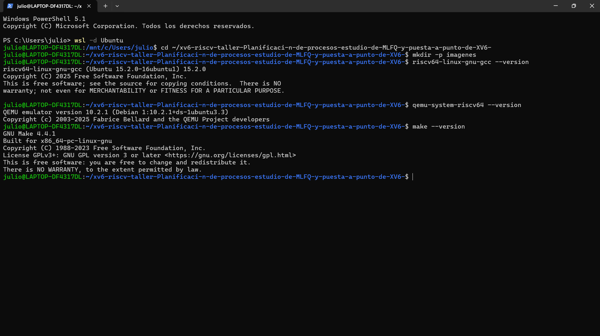
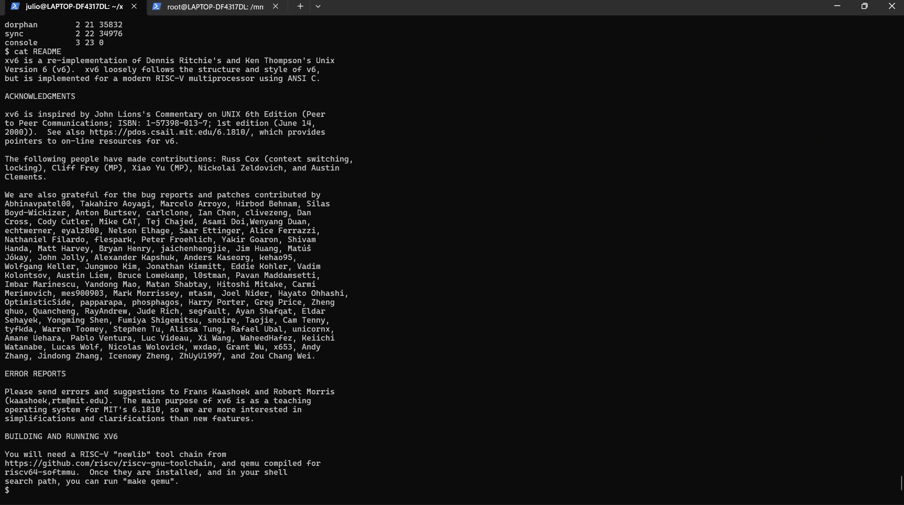

# Taller: Planificación de Procesos, Estudio de MLFQ y Puesta a Punto de XV6

## Integrantes
* **Estudiante A (Puesta a punto de XV6 y análisis del planificador original):** Julio César
* **Estudiante B (Estudio teórico de MLFQ):** Jhoan Esteban

**Repositorio:** https://github.com/Julioxx12/xv6-riscv-taller-Planificaci-n-de-procesos-estudio-de-MLFQ-y-puesta-a-punto-de-XV6-

---

## Parte A: Puesta a punto del entorno y análisis del planificador de XV6

### 1. Entorno de trabajo y herramientas instaladas

#### 1.1. Sistema operativo, kernel y commit inicial
* **Sistema Operativo:** Ubuntu 26.04 LTS (sobre WSL2 en Windows)
* **Kernel Linux:** `6.18.58.1-microsoft-standard-WSL2` (`x86_64`)
* **Repositorio:** Fork propio de `xv6-riscv`
* **Commit inicial (HEAD):** `fa2ddcb7ca87a77af579380a6eafd5aff163b44f`

#### 1.2. Herramientas verificadas
* **Compilador cruzado (`riscv64-linux-gnu-gcc`):** `15.2.0`
* **Emulador RISC-V (`qemu-system-riscv64`):** `10.2.1`
* **Construcción (`GNU Make`):** `4.4.1`



---
### 2. Compilación y ejecución de XV6 con una sola CPU virtual

Se ejecutó `make qemu CPUS=1` para sobreescribir `CPUS := 3` en el `Makefile` y arrancar QEMU con `-smp 1` (un único núcleo virtual), validando el sistema con `ls` y `cat README`:




---

### 3. Análisis del planificador original de XV6

#### 3.1. Algoritmo de planificación por defecto
XV6 implementa un planificador **Round-Robin expropiativo (*preemptive*) y sin prioridades**. Todos los procesos listos (`RUNNABLE`) reciben un *quantum* fijo gobernado por interrupciones del temporizador. El planificador recorre circularmente el arreglo estático `struct proc proc[NPROC]` (`NPROC = 64` en `kernel/param.h`) y asigna la CPU al primer proceso `RUNNABLE`.

#### 3.2. Selección del siguiente proceso en la CPU
En **`kernel/proc.c`**, la función **`scheduler(void)`** recorre `proc[]`, adquiere `p->lock` y transfiere la CPU mediante `swtch()`:

```c
// kernel/proc.c — Función scheduler()
void
scheduler(void)
{
  struct proc *p;
  struct cpu *c = mycpu();

  c->proc = 0;
  for(;;){
    intr_on();
    intr_off();
    int found = 0;
    for(p = proc; p < &proc[NPROC]; p++) {
      acquire(&p->lock);
      if(p->state == RUNNABLE) {
        p->state = RUNNING;
        c->proc = p;
        swtch(&c->context, &p->context);
        c->proc = 0;
        found = 1;
      }
      release(&p->lock);
    }
    if(found == 0)
      asm volatile("wfi");
  }
}
```

#### 3.3. Manejo de estados, cambio de contexto y eventos de CPU
* **Estados (`kernel/proc.h`):** `enum procstate { UNUSED, USED, SLEEPING, RUNNABLE, RUNNING, ZOMBIE };` almacenado en `p->state`.
* **Cambio de contexto (`kernel/proc.c` y `kernel/swtch.S`):** `sched()` invoca la rutina en ensamblador RISC-V `swtch(&p->context, &mycpu()->context)`, guardando y restaurando los registros *callee-saved* (`ra`, `sp`, `s0`–`s11`).
* **Eventos de CPU:**
  1. **Interrupción de temporizador (*Timer*):** En `kernel/trap.c` (`usertrap()` y `kerneltrap()`), cuando `which_dev == 2` se invoca **`yield()`** (`kernel/proc.c`), que pasa el proceso de `RUNNING` a `RUNNABLE` y llama a `sched()`.
  2. **Bloqueo y despertar por E/S:** `sleep(chan, lk)` pasa el proceso a `SLEEPING` y llama a `sched()`; al completarse la interrupción del dispositivo (`devintr()`), `wakeup(chan)` lo devuelve a `RUNNABLE`.
  3. **Creación y salida:** `fork()` deja al hijo en `RUNNABLE`; `exit()` lo marca `ZOMBIE` y llama a `sched()` hasta que `wait()` lo libere a `UNUSED`.

#### 3.4. Compilación e integración en el sistema
En el **`Makefile`** raíz:
1. **Objetos (`OBJS`):** Incluye `$K/proc.o`, `$K/trap.o` y `$K/swtch.o`.
2. **Compilación cruzada:** `riscv64-linux-gnu-gcc` compila `.c` y `.S` con banderas *freestanding*.
3. **Enlazado:** `riscv64-linux-gnu-ld` enlaza con `kernel/kernel.ld` (entrada en `0x80000000`) generando `kernel/kernel`.
4. **Emulación:** `make qemu CPUS=1` ejecuta `qemu-system-riscv64` con `-kernel kernel/kernel`, `fs.img` y `-smp 1`.

---

## Parte B: Estudio teórico de MLFQ (Multi-Level Feedback Queue)

> En esta parte **no se implementa MLFQ**: todo es una propuesta teórica. La propuesta se apoya en el código de la Parte A (commit `fa2ddcb7ca87a77af579380a6eafd5aff163b44f`) y en el capítulo de OSTEP *Scheduling: The Multi-Level Feedback Queue*.

### 4.1. Descripción inicial de MLFQ (escrita antes de consultar a la IA)

MLFQ (*Multilevel Feedback Queue*) es un planificador que busca dos objetivos a la vez sin saber de antemano cuánto dura cada proceso: (1) un **buen tiempo de respuesta** para los procesos interactivos y (2) un **tiempo de retorno bajo** para los trabajos cortos. Para eso usa varias colas, cada una con su propia prioridad, y observa el **comportamiento pasado** de cada proceso para decidir en qué cola ponerlo. Por eso se llama de "retroalimentación" (*feedback*).

**Reglas que conocemos:**

* **Regla 1:** si Prioridad(A) > Prioridad(B), se ejecuta A (y B no).
* **Regla 2:** si Prioridad(A) = Prioridad(B), A y B se turnan con Round Robin usando el *quantum* de esa cola.
* **Regla 3:** cuando un proceso entra al sistema, se coloca en la cola de mayor prioridad.
* **Regla 4:** cuando un proceso gasta toda su asignación de tiempo (*allotment*) en un nivel, baja un nivel, sin importar cuántas veces haya cedido la CPU antes. Así no puede "engañar" al planificador (*gaming*) cediendo la CPU justo antes de que se acabe su *quantum*.
* **Regla 5:** cada cierto periodo **S**, todos los procesos suben a la cola de mayor prioridad (*priority boost*). Esto evita la inanición de los procesos CPU-bound y permite que un proceso que cambió de comportamiento (de CPU-bound a interactivo) recupere prioridad.
* Las colas de mayor prioridad tienen *quantums* cortos (ahí quedan los interactivos/I/O-bound) y las de menor prioridad tienen *quantums* largos (ahí terminan los CPU-bound).

**Dudas que teníamos:**

1. ¿Cuántas colas conviene usar y qué *quantum*/*allotment* tiene cada una? ¿El *allotment* es igual al *quantum* o puede ser varios *quantums*?
2. ¿Cómo se escoge el valor de S? OSTEP lo llama una constante *voo-doo*: si es muy grande hay inanición; si es muy pequeño los interactivos pierden su ventaja.
3. Si está corriendo un proceso de baja prioridad y se despierta uno de prioridad alta, ¿se le quita la CPU de inmediato o al final de su *quantum*?
4. Cuando un proceso se bloquea por E/S y vuelve a estar listo, ¿entra al final o al inicio de su cola? ¿Conserva el tiempo ya gastado en ese nivel?
5. En el *boost*, ¿también se reinicia el contador de tiempo gastado?
6. En la cola más baja, ¿también se hace Round Robin?

### 4.2. Prompt 1 utilizado

* **Servicio de IA y modelo:** Claude (Anthropic) – modelo Claude Opus 5.5
* **Fecha de la conversación:** 17 de noviembre de 2026

<details>
<summary><b>Ver el Prompt 1 completo (clic para desplegar)</b></summary>

```text
Actúa como tutor socrático de una pareja de estudiantes de cuarto semestre de Ingeniería de Sistemas. Conocemos C++ y hemos comenzado a explorar XV6 para RISC-V.

Queremos identificar y justificar qué se necesitaría para incorporar MLFQ a XV6. En esta entrega no vamos a implementarlo.

Nuestra descripción inicial del algoritmo, escrita antes de esta conversación:
[Descripción de la sección 4.1: reglas 1 a 5 y dudas 1 a 6]

Lo que averiguamos del planificador original y de su incorporación al sistema compilado:
- Entorno: fork de xv6-riscv en el commit fa2ddcb7ca87a77af579380a6eafd5aff163b44f, Ubuntu 26.04 sobre WSL2, riscv64-linux-gnu-gcc 15.2.0, qemu-system-riscv64 10.2.1, ejecutado con "make qemu CPUS=1".
- Política por defecto: Round Robin sin prioridades; la CPU se cede en cada interrupción de reloj (cada tick).
- kernel/proc.c, scheduler(): ciclo infinito que recorre proc[NPROC] (NPROC = 64 en kernel/param.h); toma p->lock; si p->state == RUNNABLE lo pasa a RUNNING, c->proc = p y swtch(&c->context, &p->context).
- kernel/proc.h: struct proc (estado enum procstate: UNUSED, USED, SLEEPING, RUNNABLE, RUNNING, ZOMBIE; lock; context) y struct cpu.
- Ceder la CPU: yield() (RUNNING->RUNNABLE), sleep() (RUNNING->SLEEPING), exit() (ZOMBIE); todas llaman sched(), que hace swtch(&p->context, &mycpu()->context).
- Recuperar la CPU: wakeup() (SLEEPING->RUNNABLE), fork()/allocproc() crean procesos RUNNABLE.
- kernel/trap.c: clockintr() incrementa ticks; en usertrap() y kerneltrap(), si which_dev == 2 se llama yield(). Quantum actual = 1 tick para todos.
- Makefile: OBJS incluye $K/proc.o, $K/trap.o, $K/swtch.o; se enlaza con kernel/kernel.ld para producir kernel/kernel; CPUS controla -smp de qemu.

[Reglas de interacción 1 a 7, objetivos A, B y C y cierre: copiados textualmente de la guía de la tarea]
```

> El texto completo que se pegó en la IA está en el archivo [`prompt1.txt`](prompt1.txt) de este repositorio.

</details>

### 4.3. Intercambios significativos del diálogo socrático

> Se seleccionaron intercambios reales de la conversación con la IA (pregunta de la IA → nuestra respuesta → lo que pasó después). Se marca el tipo de cada uno: hipótesis, comprobación o corrección.

**Intercambio 1 — Tipo: hipótesis + comprobación (Regla 4)**
* **Pregunta de la IA:** Un proceso A está en nivel 0 con *allotment* de 1 tick. Corre 0,9 ticks, se bloquea por E/S, se despierta y corre otros 0,9 ticks. ¿Debería seguir en el nivel 0 o bajar? ¿Por qué?
* **Nuestra respuesta:** Baja al nivel 1, porque entre las dos veces ya sumó 1,8 ticks y se pasó del límite de 1. Aunque nos queda la duda de cómo mediría XV6 ese 0,9 si las interrupciones de reloj van de 1 en 1.
* **Retroalimentación de la IA:** La conclusión es correcta (el tiempo se acumula aunque el proceso se bloquee). La duda es muy pertinente: XV6 solo "cobra" tiempo cuando llega la interrupción de reloj y el proceso está en ejecución; un proceso que siempre se duerme justo antes del tick nunca sería cobrado.
* **Qué aprendimos:** La Regla 4 está bien planteada en teoría, pero en XV6 la medición tiene granularidad de 1 tick. Lo registramos como decisión pendiente (sección 4.6, punto 8).

**Intercambio 2 — Tipo: hipótesis + corrección (relación con `trap.c`)**
* **Pregunta de la IA:** Hoy XV6 llama `yield()` en cada interrupción de reloj dentro de `usertrap()`. Si un proceso está en el nivel 2 con *quantum* de 4 ticks, ¿qué tendría que cambiar en ese punto del código para que no pierda la CPU en el primer tick?
* **Nuestra respuesta:** Habría que agregar un contador de ticks en `struct proc` para ir sumando cada interrupción de reloj, y en `usertrap()` poner una condición para que solo llame a `yield()` cuando ese contador llegue a los 4 ticks del nivel 2.
* **Retroalimentación de la IA:** La idea del contador es correcta, pero incompleta: si durante esos 4 ticks se despierta un proceso del nivel 0, esperar a que se acabe el *quantum* violaría la Regla 1. Además, el contador debe reiniciarse al cambiar de nivel.
* **Qué aprendimos / qué cambió:** La condición en `usertrap()`/`kerneltrap()` debe ceder la CPU en dos casos: cuando se agota el *quantum* **o** cuando hay un proceso `RUNNABLE` de mayor prioridad. Y al bajar de nivel, el contador vuelve a 0 (cambio 5 de la sección 4.5).

**Intercambio 3 — Tipo: comprobación (Regla 5)**
* **Pregunta de la IA:** Hay 3 procesos interactivos que siempre tienen a alguno listo en el nivel 0 y un proceso CPU-bound en el nivel 2. Sin la Regla 5, ¿qué le pasa al CPU-bound? Con S = 50 ticks, ¿cuánto esperaría como máximo para volver a correr?
* **Nuestra respuesta:** Sin la Regla 5 nunca corre (inanición), porque siempre hay alguien en el nivel 0. Con S = 50 esperaría como máximo 50 ticks para que el *boost* lo suba al nivel 0, más los turnos de los otros 3 procesos en Round Robin.
* **Retroalimentación de la IA:** Correcto. El matiz es que en el *boost* también suben los 3 interactivos, así que en el peor caso espera unos 50 ticks más hasta 3 turnos de 1 tick en el nivel 0 antes de que le toque.
* **Qué aprendimos:** El *boost* convierte la inanición en una espera acotada aproximadamente por S + (número de procesos en nivel 0 × *quantum* del nivel 0). Esto se usa en el escenario E6.

### 4.4. Descripción revisada de la variante de MLFQ considerada

Después del diálogo fijamos una variante concreta. Los valores numéricos son **propuestos** y quedan pendientes de calibración (ver 4.6).

| Parámetro | Valor propuesto | Justificación |
| --- | --- | --- |
| Número de colas | 3 (nivel 0 = más alta, nivel 2 = más baja) | Suficiente para separar interactivos, intermedios y CPU-bound sin complicar el código. |
| *Quantum* por nivel | 1, 2 y 4 *ticks* | Nivel alto con *quantum* corto (respuesta rápida); nivel bajo con *quantum* largo (menos cambios de contexto para CPU-bound). En QEMU un *tick* son aprox. 0,1 s (`clockintr()` programa la siguiente interrupción 1 000 000 de ciclos después). |
| *Allotment* por nivel | Igual al *quantum* del nivel (1, 2 y 4 *ticks* acumulados) | Más sencillo de razonar; acumulado entre turnos (ver Regla 4). |
| Periodo de *boost* S | 50 *ticks* (aprox. 5 s) | Valor inicial razonable: mucho mayor que los *quantums* pero suficientemente corto para evitar inanición. |

**Reglas de la variante (respondiendo nuestras dudas iniciales):**

1. **Regla 1 (prioridad estricta):** siempre se elige un proceso `RUNNABLE` del nivel más alto que tenga procesos listos.
2. **Regla 2 (Round Robin por nivel):** dentro de un mismo nivel se turnan en orden circular; cada uno usa como máximo el *quantum* de su nivel antes de ceder.
3. **Regla 3 (entrada):** todo proceso nuevo (creado por `fork()` o el primer proceso `init`) empieza en el nivel 0 con contador en cero.
4. **Regla 4 (descenso con contabilidad acumulada):** el tiempo que usa un proceso en un nivel se **acumula aunque se bloquee y vuelva** (duda 4). Cuando el acumulado alcanza el *allotment* del nivel, baja un nivel y su contador vuelve a 0. En el nivel más bajo se queda ahí y hace Round Robin con *quantum* de 4 *ticks* (duda 6).
5. **Regla 5 (boost):** cada S *ticks* todos los procesos vuelven al nivel 0 **y su contador se reinicia** (duda 5); si no se reiniciara, un proceso subido volvería a bajar casi de inmediato.
6. **Expropiación (duda 3):** XV6 solo recupera el control en las interrupciones de reloj, así que un proceso de mayor prioridad que se despierta desplaza al actual **en el siguiente *tick***, no al instante. Aceptamos ese retraso máximo de 1 *tick*.
7. **Retorno de E/S (duda 4):** el proceso que se despierta queda al **final** de la cola de su nivel actual.

**Qué cambió frente a la descripción inicial:** (1) Al principio pensábamos que bastaba con un contador para que el proceso cediera la CPU solo al agotar su *quantum*. El diálogo nos hizo ver que también debe cederla si aparece un proceso de mayor prioridad (Regla 1) y que el contador se reinicia al cambiar de nivel. (2) Confirmamos que el tiempo se acumula aunque el proceso se bloquee. (3) Descubrimos que XV6 mide el tiempo en ticks enteros, lo que limita la precisión de la Regla 4.

### 4.5. Propuesta de cambios en XV6

Cada cambio indica **qué necesidad atiende**, **qué regla** cumple y la **evidencia del código** (Parte A) que lo justifica.

| # | Archivo / función | Cambio propuesto | Necesidad que atiende y por qué | Regla |
| --- | --- | --- | --- | --- |
| 1 | `kernel/proc.h` — `struct proc` | Agregar campos: nivel actual (`level`), *ticks* usados en el nivel (`ticks_used`) y un valor de orden para el RR dentro del nivel (por ejemplo, el *tick* en que el proceso quedó `RUNNABLE`). Opcional para pruebas: *ticks* totales por nivel. | Hoy `struct proc` solo guarda `state`; no hay ningún dato de prioridad ni de historia de uso de CPU. MLFQ decide con base en ese historial, así que debe vivir en cada proceso. | 1, 2, 4 |
| 2 | `kernel/param.h` | Constantes: número de niveles, *quantum*/*allotment* por nivel y periodo S. | `param.h` ya centraliza límites como `NPROC = 64`; tener los parámetros ahí facilita calibrarlos sin tocar la lógica. | 2, 4, 5 |
| 3 | `kernel/proc.c` — `allocproc()` (y por tanto `fork()` y `userinit()`) | Inicializar `level = 0` y `ticks_used = 0` al crear el proceso; limpiarlos en `freeproc()`. | Todos los procesos nacen en `allocproc()`; ahí se garantiza que entren por la cola de mayor prioridad. | 3 |
| 4 | `kernel/proc.c` — `scheduler()` | Cambiar el recorrido lineal de `proc[]` por una selección en dos pasos: (a) encontrar el nivel más alto con algún proceso `RUNNABLE`; (b) dentro de ese nivel, elegir en orden circular (el que lleva más tiempo esperando). | El `scheduler()` actual toma el primer `RUNNABLE` que encuentra en `proc[]` sin mirar prioridad: eso es exactamente el RR que hay que reemplazar. | 1, 2 |
| 5 | `kernel/trap.c` — `usertrap()` y `kerneltrap()` (rama `which_dev == 2`) | En vez de llamar `yield()` en cada *tick*: sumar 1 a `ticks_used` del proceso actual; si alcanzó el *allotment*, bajarlo de nivel, reiniciar el contador y llamar `yield()`; si agotó el *quantum* o hay un `RUNNABLE` de mayor prioridad, llamar `yield()`; si no, dejarlo seguir. | Hoy el *quantum* es fijo de 1 *tick* porque se cede la CPU en cada interrupción de reloj. Aquí es donde se mide el uso de CPU y donde se aplica el *quantum* variable. | 1, 2, 4 |
| 6 | `kernel/trap.c` — `clockintr()` | Cada S *ticks* (usando la variable global `ticks`), recorrer `proc[]` y poner todos los procesos en nivel 0 con contador en 0. | `clockintr()` ya lleva la cuenta global de `ticks`; es el lugar natural para detectar que pasó un periodo S. | 5 |
| 7 | `kernel/proc.c` — `sleep()` / `wakeup()` | **No** reiniciar `ticks_used` al dormir; en `wakeup()` actualizar el valor de orden para que el proceso quede al final de su cola. | Si se reiniciara al dormir, un proceso podría hacer *gaming* (usar casi todo el *quantum* y dormir un instante). | 2, 4 |
| 8 | `kernel/proc.c` — `procdump()` | Mostrar nivel y *ticks* usados de cada proceso al presionar Ctrl+P en la consola. | Permite **observar** el planificador sin herramientas extra, lo que necesitamos para los escenarios de la sección 4.7. | Pruebas |
| 9 | Nueva llamada al sistema (p. ej. `getpinfo`): `kernel/syscall.h`, `kernel/syscall.c`, `kernel/sysproc.c`, `user/user.h`, `user/usys.pl` | Devolver a un programa de usuario el nivel y los *ticks* por nivel de los procesos. | Para que los programas de prueba puedan verificar automáticamente las reglas. | Pruebas |
| 10 | `Makefile` — `UPROGS` | Agregar los futuros programas de prueba de usuario (`user/_...`) y ejecutar siempre con `CPUS=1`. | Así se compilan y quedan dentro de `fs.img`, igual que `ls` o `cat` (Parte A, sección 3.4). | Pruebas |

### 4.6. Decisiones que necesitan investigación o soporte adicional

1. **Estructura de las colas:** ¿basta con recorrer `proc[]` (64 entradas) filtrando por nivel, o conviene tener listas enlazadas por nivel? Recorrer es más simple y respeta el *lock* por proceso que ya usa XV6; las listas son más eficientes pero exigen un *lock* global nuevo. Hay que estudiar el impacto en la sincronización.
2. **Orden de los *locks*:** para saber si hay un proceso de mayor prioridad (cambio 5) o para hacer el *boost* (cambio 6) hay que mirar otros procesos mientras se tiene el *lock* del actual. Hay que confirmar en el libro de XV6 (capítulo de *scheduling* y *locking*) si eso puede causar *deadlock*.
3. **¿`clockintr()` corre en todas las CPU?** En nuestra versión hay que verificar si `ticks` solo se incrementa en la CPU 0. Con `CPUS=1` no es problema, pero con varias CPU sí.
4. **Calibración de *quantums* y de S:** los valores 1/2/4 y S = 50 son una hipótesis; habría que medirlos con los escenarios de prueba.
5. **Expropiación inmediata:** decidimos esperar al siguiente *tick*. Habría que investigar si vale la pena forzar un cambio cuando `wakeup()` despierta a un proceso de mayor prioridad.
6. **Procesos del sistema (`init`, `sh`):** ¿deben participar en MLFQ igual que los demás o tener un trato especial?
7. **Varias CPU:** queda fuera del alcance; una cola compartida entre CPU necesita otro diseño de *locks*.
8. **Granularidad de la medición (surgió en el intercambio 1):** XV6 solo cuenta tiempo en cada interrupción de reloj. Un proceso que se duerme siempre justo antes del tick nunca sería cobrado y podría seguir haciendo *gaming*. Habría que investigar si conviene medir el tiempo real de ejecución leyendo el contador de tiempo del procesador (`r_time()`, usado en `kernel/trap.c`) al entrar y salir de la CPU.

### 4.7. Escenarios para comprobar una futura implementación

> Solo se describen; **no se programan ni se ejecutan**. Todos asumen `make qemu CPUS=1` y que el nivel de cada proceso se puede observar con Ctrl+P (`procdump()`) o con la llamada `getpinfo` propuesta.

| # | Procesos que participan | Qué hacen | Regla que se comprueba | Comportamiento esperado si la implementación es correcta |
| --- | --- | --- | --- | --- |
| E1 | 1 proceso CPU-bound (`cpu`) | Un ciclo infinito de cálculo, sin E/S. | Regla 3 y Regla 4 | Empieza en nivel 0; después de 1 *tick* pasa a nivel 1, después de 2 *ticks* más pasa a nivel 2 y se queda ahí (hasta un *boost*). |
| E2 | 1 CPU-bound largo + 1 trabajo corto que llega después | El largo lleva varios *ticks* en nivel 2; luego se lanza el corto (pocos *ticks* de cálculo). | Regla 3 y Regla 1 | El corto entra en nivel 0, toma la CPU en el siguiente *tick* y termina mucho antes que si compitiera en RR; el largo no corre mientras el corto esté listo en un nivel superior. |
| E3 | 2 CPU-bound idénticos (A y B) lanzados al mismo tiempo | Mismo ciclo de cálculo. | Regla 2 | Bajan juntos de nivel y, en el mismo nivel, se alternan; al final ambos acumulan una cantidad de *ticks* casi igual (diferencia ≤ 1 *quantum*). |
| E4 | 1 proceso interactivo + 1 CPU-bound | El interactivo duerme (llamada de dormir de XV6) y despierta para hacer muy poco cálculo; el CPU-bound calcula sin parar. | Regla 1 (respuesta de interactivos) | El interactivo se mantiene en niveles altos y, al despertar, obtiene la CPU en a lo sumo 1 *tick*; el CPU-bound termina en el nivel 2. |
| E5 | 1 proceso "tramposo" + 1 CPU-bound | El tramposo calcula casi todo su *quantum* y duerme 1 *tick* justo antes de que se acabe, repetidamente. | Regla 4 (anti-*gaming*) | Como el tiempo se acumula, el tramposo **también baja de nivel** y no monopoliza la CPU; el CPU-bound sigue recibiendo CPU. |
| E6 | 3 interactivos en nivel 0 + 1 CPU-bound en nivel 2 | Los interactivos mantienen siempre algún proceso listo en nivel 0. | Regla 5 (*boost* / anti-inanición) | Sin *boost* el CPU-bound casi no correría; con *boost* sube a nivel 0 cada S *ticks* y recibe CPU al menos una vez por periodo. Su tiempo de espera máximo queda acotado por S. |
| E7 | 1 proceso que cambia de comportamiento | Primero calcula sin parar varios segundos (baja a nivel 2) y luego pasa a hacer E/S frecuente. | Regla 5 (cambio de comportamiento) | Después del siguiente *boost* vuelve a nivel 0 y, como ahora es interactivo, se queda en niveles altos. |

### 4.8. Conclusiones y retroalimentación de la IA

**Nuestras conclusiones:**

1. El planificador original de XV6 es un RR puro: no hay datos de prioridad en `struct proc` y el *quantum* es siempre 1 *tick*, porque `usertrap()`/`kerneltrap()` llaman `yield()` en cada interrupción de reloj.
2. Para MLFQ no basta con cambiar `scheduler()`: la **decisión** de qué proceso corre está en `kernel/proc.c`, pero la **medición** del uso de CPU y el **momento** de ceder están en `kernel/trap.c`. Los dos archivos se tienen que modificar de forma coordinada.
3. La Regla 4 en su versión con contabilidad acumulada es clave: sin ella, un proceso puede quedarse siempre en la cola más alta.
4. Los parámetros (número de colas, *quantums*, S) no tienen un valor "correcto" universal; se deben calibrar con escenarios como los de 4.7.

**Retroalimentación de la IA sobre nuestras conclusiones:** Las conclusiones son coherentes con lo que trabajamos. La IA destacó que la conclusión 2 (decisión en `proc.c` y medición en `trap.c`) es la idea central de la propuesta. Para la conclusión 3, señaló que la Regla 4 solo es tan buena como la medición del tiempo: con la granularidad de 1 tick de XV6, un proceso que siempre se duerme antes de la interrupción de reloj podría seguir engañando al planificador. Por eso agregamos el punto 8 en la sección 4.6 y el escenario E5 debe incluir esa variante (dormir justo antes del tick).

---

## Reflexiones Individuales

### Reflexión — Estudiante A (Julio César)
La puesta a punto de `xv6-riscv` mediante compilación cruzada y emulación en QEMU permitió observar cómo funciona un planificador real desde el hardware hasta el código del kernel. Al inspeccionar `scheduler()`, `yield()` y `swtch()`, queda claro que el Round-Robin simple de XV6 prioriza la simplicidad y la equidad básica frente a la capacidad de respuesta: todos los procesos compiten por el mismo *quantum* sin distinguir tareas interactivas de cargas intensivas de CPU. Contrastar esta arquitectura con MLFQ evidencia por qué los sistemas operativos modernos introducen múltiples colas dinámicas y mecanismos de *priority boost* para equilibrar latencia y rendimiento.

### Reflexión — Estudiante B (Jhoan Esteban)
Comprendí que MLFQ no necesita saber cuánto dura un proceso porque lo deduce de su comportamiento: si usa toda su porción de CPU baja de prioridad y si la cede pronto se queda arriba. Lo que más me costó fue la Regla 4: al principio pensaba que el contador se reiniciaba cuando el proceso se bloqueaba, y con el diálogo socrático vi que así un proceso podría engañar al planificador. Mi aporte fue la descripción inicial y revisada del algoritmo, la propuesta de cambios relacionándola con `scheduler()`, `yield()` y `usertrap()` que analizó mi compañero, y los escenarios de prueba. Me falta estudiar cómo manejar los *locks* de `proc[]` al hacer el *priority boost* sin causar *deadlocks*, y cómo cambiaría el diseño con varias CPU.
