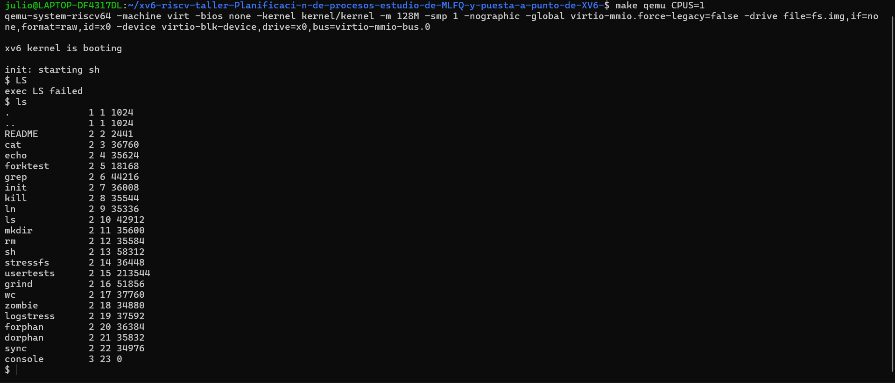

# Taller: Planificación de Procesos, Estudio de MLFQ y Puesta a Punto de XV6

## Integrantes
* **Estudiante A (Puesta a punto de XV6 y análisis del planificador original):** Julio César
* **Estudiante B (Estudio teórico de MLFQ):** [Nombre de tu compañero]

---

## Parte A: Puesta a punto del entorno y análisis del planificador de XV6

### 1. Entorno de trabajo y herramientas instaladas

#### 1.1. Sistema operativo, kernel y commit inicial
* **Sistema Operativo:** Ubuntu 26.04 LTS (sobre WSL2 en Windows)
* **Kernel Linux:** `6.18.58.1-microsoft-standard-WSL2` (`x86_64`)
* **Repositorio:** Fork propio de `xv6-riscv`
* **Commit inicial (HEAD):** `fa2ddcb7ca87a77af579380a6eafd5aff163b44f`

#### 1.2. Herramientas verificadas
* **Compilador cruzado (`riscv64-linux-gnu-gcc`):** `15.2.0`
* **Emulador RISC-V (`qemu-system-riscv64`):** `10.2.1`
* **Construcción (`GNU Make`):** `4.4.1`


---
### 2. Compilación y ejecución de XV6 con una sola CPU virtual

Se ejecutó `make qemu CPUS=1` para sobreescribir `CPUS := 3` en el `Makefile` y arrancar QEMU con `-smp 1` (un único núcleo virtual), validando el sistema con `ls` y `cat README`:




---

### 3. Análisis del planificador original de XV6

#### 3.1. Algoritmo de planificación por defecto
XV6 implementa un planificador **Round-Robin expropiativo (*preemptive*) y sin prioridades**. Todos los procesos listos (`RUNNABLE`) reciben un *quantum* fijo gobernado por interrupciones del temporizador. El planificador recorre circularmente el arreglo estático `struct proc proc[NPROC]` (`NPROC = 64` en `kernel/param.h`) y asigna la CPU al primer proceso `RUNNABLE`.

#### 3.2. Selección del siguiente proceso en la CPU
En **`kernel/proc.c`**, la función **`scheduler(void)`** recorre `proc[]`, adquiere `p->lock` y transfiere la CPU mediante `swtch()`:

```c
// kernel/proc.c — Función scheduler()
void
scheduler(void)
{
  struct proc *p;
  struct cpu *c = mycpu();

  c->proc = 0;
  for(;;){
    intr_on();
    intr_off();
    int found = 0;
    for(p = proc; p < &proc[NPROC]; p++) {
      acquire(&p->lock);
      if(p->state == RUNNABLE) {
        p->state = RUNNING;
        c->proc = p;
        swtch(&c->context, &p->context);
        c->proc = 0;
        found = 1;
      }
      release(&p->lock);
    }
    if(found == 0)
      asm volatile("wfi");
  }
}
```

#### 3.3. Manejo de estados, cambio de contexto y eventos de CPU
* **Estados (`kernel/proc.h`):** `enum procstate { UNUSED, USED, SLEEPING, RUNNABLE, RUNNING, ZOMBIE };` almacenado en `p->state`.
* **Cambio de contexto (`kernel/proc.c` y `kernel/swtch.S`):** `sched()` invoca la rutina en ensamblador RISC-V `swtch(&p->context, &mycpu()->context)`, guardando y restaurando los registros *callee-saved* (`ra`, `sp`, `s0`–`s11`).
* **Eventos de CPU:**
  1. **Interrupción de temporizador (*Timer*):** En `kernel/trap.c` (`usertrap()` y `kerneltrap()`), cuando `which_dev == 2` se invoca **`yield()`** (`kernel/proc.c`), que pasa el proceso de `RUNNING` a `RUNNABLE` y llama a `sched()`.
  2. **Bloqueo y despertar por E/S:** `sleep(chan, lk)` pasa el proceso a `SLEEPING` y llama a `sched()`; al completarse la interrupción del dispositivo (`devintr()`), `wakeup(chan)` lo devuelve a `RUNNABLE`.
  3. **Creación y salida:** `fork()` deja al hijo en `RUNNABLE`; `exit()` lo marca `ZOMBIE` y llama a `sched()` hasta que `wait()` lo libere a `UNUSED`.

#### 3.4. Compilación e integración en el sistema
En el **`Makefile`** raíz:
1. **Objetos (`OBJS`):** Incluye `$K/proc.o`, `$K/trap.o` y `$K/swtch.o`.
2. **Compilación cruzada:** `riscv64-linux-gnu-gcc` compila `.c` y `.S` con banderas *freestanding*.
3. **Enlazado:** `riscv64-linux-gnu-ld` enlaza con `kernel/kernel.ld` (entrada en `0x80000000`) generando `kernel/kernel`.
4. **Emulación:** `make qemu CPUS=1` ejecuta `qemu-system-riscv64` con `-kernel kernel/kernel`, `fs.img` y `-smp 1`.

---

## Parte B: Estudio teórico de MLFQ (Multi-Level Feedback Queue)

> **[Pegar aquí el desarrollo completo de la Parte B elaborado por el Estudiante B: reglas de MLFQ, CPU-bound vs I/O-bound, priority boost, gaming the scheduler, escenarios teóricos y enlace/síntesis de la sesión socrática].**

---

## Reflexiones Individuales

### Reflexión — Estudiante A (Julio César)
La puesta a punto de `xv6-riscv` mediante compilación cruzada y emulación en QEMU permitió observar cómo funciona un planificador real desde el hardware hasta el código del kernel. Al inspeccionar `scheduler()`, `yield()` y `swtch()`, queda claro que el Round-Robin simple de XV6 prioriza la simplicidad y la equidad básica frente a la capacidad de respuesta: todos los procesos compiten por el mismo *quantum* sin distinguir tareas interactivas de cargas intensivas de CPU. Contrastar esta arquitectura con MLFQ evidencia por qué los sistemas operativos modernos introducen múltiples colas dinámicas y mecanismos de *priority boost* para equilibrar latencia y rendimiento.

### Reflexión — Estudiante B ([Nombre de tu compañero])
> **[Pegar aquí la reflexión personal de tu compañero].**
